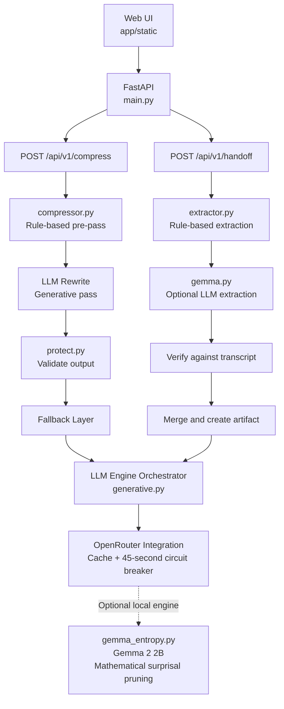

# 📦 ContextPack

**Compress your prompts. Carry your context.**

ContextPack is an API-first service built with FastAPI, featuring a web dashboard to streamline developer workflows through two core capabilities:

1. **Prompt Compression** — Shortens prompts while preserving critical information, including instructions, numbers, negations, quoted strings, URLs, and code.
2. **Context Handoff** — Transforms long, unstructured chat transcripts into compact, structured Markdown artifacts that can be transferred to a new conversation without losing essential context.

Both engines follow a strict **zero-trust principle**: model-generated outputs are never inherently trusted. Outputs are validated against the original input, and the service falls back to deterministic rules whenever validation fails.

---

## 🗺️ System Architecture



### Project Structure

```text
Hacktoberfest-DevWeek-2/
├── app/
│   ├── core/                  # Sentry tracing
│   ├── routers/
│   │   ├── compress.py        # /api/v1/compress
│   │   └── handoff.py         # Handoff and snapshot endpoints
│   ├── services/
│   │   ├── compressor.py     # Compression pipeline
│   │   ├── protect.py        # Protected-token detection
│   │   ├── generative.py     # LLM provider chain
│   │   ├── gemma.py          # Handoff extraction via provider chain
│   │   ├── extractor.py     # Rule-based extraction and verification
│   │   └── gemma_entropy.py # Optional local Gemma 2 2B engine
│   ├── static/
│   │   ├── index.html
│   │   ├── app.js
│   │   └── style.css
│   └── db.py                 # SQLite snapshot storage
├── tests/                     # Automated tests
├── main.py                    # Application entry point
├── requirements.txt
├── .env.example
└── README.md
```

---

## ✂️ Prompt Compression

ContextPack reduces prompt length while protecting information that must remain unchanged.

### Modes

| Mode | Description |
|---|---|
| `hybrid` (default) | Applies rule-based cleanup, an LLM rewrite, and validation. Unknown modes use this pipeline. |
| `generative` | Uses the hybrid pipeline; retained for the UI option. |
| `rule` | Performs deterministic regex-based cleanup of filler phrases, wordy expressions, and greetings. No network calls. |
| `gemma_entropy` (`entropy`) | Uses an optional local Gemma 2 2B model for surprisal-based pruning. |

The `drop_rate` parameter defaults to `0.40` and controls the target reduction. The LLM is asked to shorten the prompt accordingly, while the entropy engine removes the target fraction of unprotected words.

### Safety and Validation

- **Protected spans:** Negations (`not`, `never`, `don't`, etc.), numbers, quoted strings, ALL-CAPS words, `Label:` patterns, `[placeholders]`, URLs, email addresses, non-ASCII text, inline and fenced code, and content inside `<data>...</data>` blocks are protected.
- **LLM validation:** Every rewrite must be shorter than the input, avoid conversational preambles, preserve the original vocabulary, retain protected spans verbatim and case-sensitively, and pass a meaning audit.
- **Instruction preservation:** Important instruction words such as `only`, `exactly`, `tone`, and `format` are checked to reduce the risk of changing the original intent.
- **Final verification:** The output is checked again using `missing_critical()`.
- **Fallback behavior:** Rejected rewrites fall back to rule-based output. The original prompt is returned unchanged only as a last resort (`engine = "passthrough"`).
- **Performance safeguards:** Prompts up to 1,200 tokens are rewritten in one call. Larger prompts send only their largest prose paragraphs, up to three in parallel. Code fences and `<data>` blocks are excluded from this LLM stage, which has an eight-second deadline.

> **Tip:** Wrap customer emails, logs, or other payloads in `<data>...</data>` so that only your instructions are compressed.

### API Example

```bash
curl -X POST http://localhost:8000/api/v1/compress \
  -H "Content-Type: application/json" \
  -d '{"prompt": "Can you please help me write unit tests? Thank you so much!", "mode": "hybrid"}'
```

**Response fields:**

`original_prompt`, `compressed_prompt`, `mode_used`, `engine_used`, `original_tokens`, `compressed_tokens`, `tokens_saved`, `compression_ratio`, `latency_ms`.

### Optional: Local Gemma 2 2B Entropy Engine

The `gemma_entropy` engine runs a forward pass through Gemma 2 2B, calculates average token surprisal per word, and removes the most predictable unprotected words.

It does not generate text, but it is not instantaneous. Processing may take tens to hundreds of milliseconds on a GPU and significantly longer on a CPU.

Install the dependencies:

```bash
pip install torch transformers
```

Configure your Hugging Face token:

```bash
export HF_TOKEN=your_huggingface_token
```

Gemma is gated, so accept the model license on Hugging Face before loading it.

If the model cannot be loaded, the engine falls back to a safe filler-word filter that removes only words such as `a`, `the`, and `very`. The reported engine is `protected-filler-fallback`.

Set `GEMMA_ENTROPY_WINDOW` to change the number of tokens processed per pass. The default is `2048`.

---

## 🔄 Context Handoff

The Context Handoff engine converts a multi-turn conversation into a structured Markdown artifact that can be pasted into a new chat.

### How It Works

1. **Rule-based extraction:** Always runs. Detects the tech stack, decisions, completed work, constraints, failed approaches, open issues, key files, endpoints, and the most recent next step. Empty sections remain empty rather than being invented.
2. **Optional LLM extraction:** Runs when a provider key is configured. Long transcripts are split into chunks of 30,000 characters, with up to six chunks processed in parallel.
3. **Verification:** LLM-generated items are checked against the original transcript. Unsupported words or numbers are removed, omitted or weakened constraints are restored from the rule-based results, and detected filenames and technologies are merged in.
4. **Artifact generation:** The verified information is formatted as Markdown, token savings are calculated, and a snapshot is stored in SQLite.

### What's Included in a Handoff?

Each artifact can contain:

- Project summary
- Technology stack
- Key decisions
- Completed work
- Strict constraints
- Failed approaches
- Open issues
- Important files and API endpoints
- Immediate next task

### API Example

```bash
curl -X POST http://localhost:8000/api/v1/handoff \
  -H "Content-Type: application/json" \
  -d '{"project_name": "MyProject", "raw_transcript": "We decided to use SQLite. You must not change the API format. Next, add auth."}'
```

**Response fields:**

`snapshot_id`, `project_name`, `structured_data`, `formatted_markdown`, `tokens_saved`, `original_tokens`, `artifact_tokens`, `engine`, and `notes`.

The `engine` field indicates whether the artifact used `gemma-api (verified against transcript)` or `rule-based`. The `notes` field records changes made during verification.

### Snapshot Endpoints

| Endpoint | Purpose |
|---|---|
| `GET /api/v1/handoff/latest?project_name=X` | Retrieves the latest artifact for a project. |
| `GET /api/v1/handoff/{snapshot_id}` | Retrieves a specific snapshot. |
| `GET /api/v1/handoff?project_name=X&limit=20` | Lists snapshots, newest first. |
| `GET /api/v1/projects` | Lists projects with their snapshot counts. |

---

## 🚀 Quickstart

### 1. Clone the Repository

```bash
git clone https://github.com/aaryanideas28/Hacktoberfest-DevWeek-2.git
cd Hacktoberfest-DevWeek-2
```

### 2. Create and Activate a Virtual Environment

**macOS / Linux**

```bash
python -m venv .venv
source .venv/bin/activate
```

**Windows PowerShell**

```powershell
python -m venv .venv
.venv\Scripts\Activate.ps1
```

### 3. Install Dependencies

```bash
pip install -r requirements.txt
```

### 4. Configure Environment Variables

Create a local `.env` file:

```bash
cp .env.example .env
```

On Windows Command Prompt:

```cmd
copy .env.example .env
```

Configure at least one LLM provider key. Without a key, the application can still run using rule-based compression and extraction.

### 5. Start the Application

```bash
uvicorn main:app --reload
```

Open the following URLs:

- **Web Studio:** http://localhost:8000
- **Interactive API documentation:** http://localhost:8000/docs

### 6. Run Tests

```bash
pytest
```

---

## ⚙️ Configuration

| Variable | Purpose | Default |
|---|---|---|
| `GOOGLE_API_KEY` / `GEMINI_API_KEY` | Google AI Studio API key | None |
| `GOOGLE_MODEL` | Google model name | `gemini-2.5-flash` |
| `OPENROUTER_API_KEY` | OpenRouter API key | None |
| `OPENROUTER_MODEL` | OpenRouter model name | `google/gemma-4-31b-it:free` |
| `HF_TOKEN` | Hugging Face token for the local Gemma 2 2B engine | None |
| `GEMMA_ENTROPY_WINDOW` | Tokens processed per forward pass | `2048` |
| `CONTEXTSWITCH_DB` | SQLite database path | `contextswitch.db` in the project root |
| `SENTRY_DSN` | Enables Sentry tracing | None |

### LLM Provider Behavior

- Google is tried first, followed by OpenRouter.
- A provider that fails is skipped for 45 seconds.
- Identical requests are served from an in-memory cache with a capacity of 256 entries.

The `GET /api/v1/health` endpoint reports whether an LLM provider and Sentry are configured.

---

## ⚠️ Limitations

- **Heuristic-based processing:** Compression and extraction use a combination of heuristics and LLMs. Review important prompts and handoff artifacts before relying on them.
- **Strict verification:** Extracted items may be removed if their wording or numbers cannot be matched to the original transcript. For example, `three` may not match `3`; the `notes` field reports such removals.
- **Handoff size:** For short transcripts, the generated artifact may be longer than the original because of its introduction and section headings. Token savings are more likely with longer conversations.
- **Token estimation:** Token counts use the Gemma tokenizer when available. Otherwise, the service estimates approximately four characters per token.